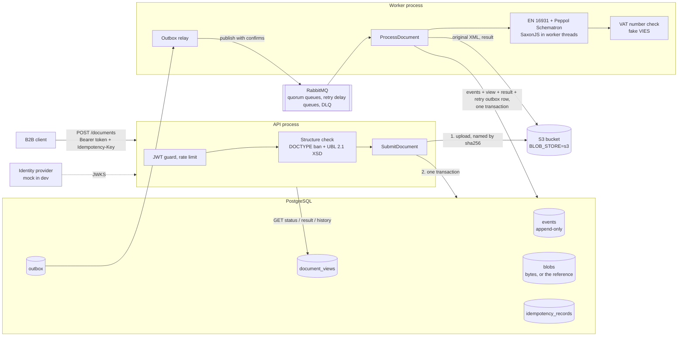
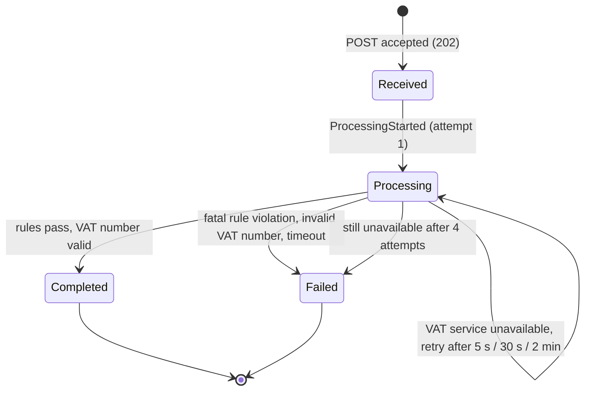

# xml-invoice-processor

A backend that receives **Peppol BIS Billing 3.0 invoices (UBL 2.1 XML)** from B2B systems over
HTTPS, validates them, stores them so that an accepted document is never lost, and processes them
asynchronously. Every document has a status: `Received`, `Processing`, `Completed` or `Failed`.

- [Quick start](#quick-start)
- [Check that it really ran](#check-that-it-really-ran)
- [API](#api)
- [Support view](#support-view)
- [Architecture](#architecture)
- [Reliability: what happens when something fails](#reliability-what-happens-when-something-fails)
- [Key decisions and trade-offs](#key-decisions-and-trade-offs)
- [Assumptions](#assumptions)
- [Security](#security)
- [Testing, CI/CD and monitoring](#testing-cicd-and-monitoring)
- [Next steps](#next-steps)
- [AI usage](#ai-usage)

## Quick start

Requirements: Docker with Compose v2 (2 GB of memory for the VM is enough; building the images
yourself needs buildx 0.17 or newer), Node 22 and pnpm 10 (through Corepack) for the demo script.

```bash
git clone https://github.com/gimme4bucks/xml-invoice-processor.git && cd xml-invoice-processor
corepack enable && pnpm install
docker compose --profile full up -d --build --wait   # Postgres, RabbitMQ, migrations, API, worker, mock IdP, support app, HTTPS edge
pnpm demo                                            # walks through every scenario against the running stack
pnpm e2e                                             # the end-to-end tests, including RabbitMQ and Postgres outages
docker compose --profile full down --volumes         # stop everything and remove the data (and the edge's CA)
```

The first build takes a few minutes: it downloads the Peppol rules (sha256-checked) and compiles
them. To skip it, use the published release images instead: they are public on GHCR
(`ghcr.io/gimme4bucks/xml-invoice-processor`, `-mock-idp` and `-web`, linux/amd64 and linux/arm64).

```bash
docker compose --profile full pull           # the latest release; prefix both commands with TAG=1.1.0 to pin it
docker compose --profile full up -d --wait   # no --build: uses the pulled images
```

`pnpm demo` prints each step; it ends with `All scenarios behaved as expected.` The
[examples](examples/README.md) show the same flows with curl, the demo clients and what each
example invoice does.

The API, the mock IdP and the support app are only reachable over HTTPS, through a Caddy reverse
proxy (the `edge`) with its own local CA ([ADR 0013](docs/adr/0013-tls-at-the-edge.md)). `pnpm demo` and
`pnpm e2e` export its root certificate and trust it by themselves; nothing switches certificate
verification off. For curl, `pnpm tls:ca` exports it to `.tls/edge-root-ca.crt`:

```bash
curl --cacert "$(pnpm -s tls:ca)" https://localhost:3443/health   # {"status":"ok"}
```

| What                   | Where                                                                                  |
| ---------------------- | -------------------------------------------------------------------------------------- |
| API                    | https://localhost:3443                                                                 |
| OpenAPI (Swagger UI)   | https://localhost:3443/docs, JSON at `/openapi.json` (the browser warns, see below)    |
| Mock identity provider | https://localhost:4443 (`POST /token`, `/.well-known/jwks.json`)                       |
| Support view (browser) | https://localhost:5443, user `support-agent` (see [Support view](#support-view))       |
| Edge root certificate  | `pnpm tls:ca` (a new one after `down --volumes`)                                       |
| RabbitMQ management    | http://127.0.0.1:15672 (user `xip`, password `xip`; a local tool, not behind the edge) |

The demo clients and their secrets in `docker-compose.yml` are for local use only. A browser
does not know the edge's CA, so Swagger UI shows a certificate warning, and the support view
cannot reach the API, unless you trust `.tls/edge-root-ca.crt` in your system or browser
([how](#trusting-the-local-ca-in-a-browser)).

**Local development** (Node processes against Dockerised Postgres and RabbitMQ):

```bash
corepack enable && pnpm install
cp .env.example .env && cp .env.example apps/service/.env
pnpm infra:up                                  # Postgres 18 + RabbitMQ 4.4
pnpm -F @xip/service prisma:generate && pnpm -F @xip/service prisma:migrate
pnpm -F @xip/service build:validation          # fetches and compiles the Schematron rules
pnpm verify                                    # format, lint, types, architecture rules, unit tests, build
pnpm test:contract                             # the port contracts against real Postgres and RabbitMQ
```

During local development the API (port 3000) and the mock IdP (port 4000) run natively and speak
plain HTTP on `localhost`; only the full compose stack has the HTTPS edge.

## Check that it really ran

`pnpm demo` checks every response itself and exits with a non-zero code when one is wrong. These
are five ways to see for yourself that the documents really went through Postgres, RabbitMQ and
the worker, against the running stack from the quick start.

**1. Stop the worker.** Processing depends on the worker, and nothing is lost while it is down:

```bash
docker compose stop worker
pnpm demo                    # stops at "Received (attempts: 0)" for the first invoice
docker compose start worker  # in a second terminal, within 90 seconds
```

While the worker is down, the document waits in the outbox table, because the outbox relay runs in
the worker. RabbitMQ stays empty in the meantime:

```bash
docker compose exec postgres psql -U xip -d xip -c "select routing_key, created_at from outbox where published_at is null"
```

Once the worker is up, the demo continues and ends as usual. In the history it prints, the gap
between `DocumentReceived` and the first `ProcessingStarted` is the time the worker was down. If
you wait longer than 90 seconds, the demo gives up with `… is still Received`, but the document is
still processed as soon as the worker starts.

**2. The event history in Postgres.** Every document has its own event stream. Its document ID is
the one the demo prints:

```bash
docker compose exec postgres psql -U xip -d xip -c "
  select d.document_id, d.status, d.attempts,
         string_agg(e.type, ' > ' order by e.version) as history
  from document_views d join events e on e.stream_id = d.document_id
  group by d.document_id, d.status, d.attempts, d.received_at
  order by d.received_at"
```

The API returns the same history at `GET /documents/{id}/history`, which you can also call from the
Swagger UI with a token from the mock IdP (see the [examples](examples/README.md)).

**3. RabbitMQ management** (http://127.0.0.1:15672, user `xip`, password `xip`):

- Under _Queues_, `documents.process` carries every document, and its message rates rise while the demo runs.
- The `documents.retry.*` queues receive the VIES retries.
- `documents.dlq` stays empty.

The retry queues are named after the production delays (5 s, 30 s and 2 min). Compose shortens them
to 1, 2 and 5 seconds (`RETRY_DELAYS_MS`, shown as `x-message-ttl` on each queue) to keep the demo
quick.

**4. The API logs.** This shows every request from the demo as a JSON line with its correlation id:

```bash
docker compose logs -f api | grep -v /health
```

The worker writes one JSON line for every message it handles: document id, attempt, outcome,
duration and the correlation id from the intake request. The same correlation id therefore links
a request to its processing:

```bash
docker compose logs -f worker
```

**5. HTTPS at the edge.** The certificate is verified against the edge's own CA, verification
fails without it, and plain HTTP is refused instead of redirected:

```bash
curl -sv --cacert "$(pnpm -s tls:ca)" https://localhost:3443/health 2>&1 | grep -E 'issuer|SSL certificate verify|strict'
curl -sS https://localhost:3443/health       # without the CA: "SSL certificate problem: unable to get local issuer certificate"
curl -si http://localhost:3443/health        # plain HTTP: 400 "Client sent an HTTP request to an HTTPS server", no Location
docker compose ps api mock-idp               # no host ports: only the edge publishes 3443 and 4443
```

## API

All endpoints need an OAuth2 bearer token. Organisations use client credentials; the organisation
always comes from the token, never from the URL or the body. Support staff sign in with
Authorization Code + PKCE and get a token with `support:read` and no organisation, which only
reaches the read-only `/support` endpoints ([ADR 0017](docs/adr/0017-support-access-with-pkce.md)).

| Method and path                       | Scope              | Purpose                                                                                                                                 |
| ------------------------------------- | ------------------ | --------------------------------------------------------------------------------------------------------------------------------------- |
| `POST /documents`                     | `documents:submit` | Submit one invoice or credit note (`application/xml`, UTF-8, at most 1 MiB, `Idempotency-Key` required). Answers `202` with `Location`. |
| `GET /documents`                      | `documents:read`   | Your organisation's documents, newest first (`status`, `type`, `limit`, `cursor`).                                                      |
| `GET /documents/{id}`                 | `documents:read`   | Document type (`Invoice` or `CreditNote`), status, direction (purchase or sales), attempts and failure reason.                          |
| `GET /documents/{id}/result`          | `documents:read`   | The processing result once `Completed`: the canonical JSON `invoice` or `creditNote`.                                                   |
| `GET /documents/{id}/history`         | `documents:read`   | The document's event stream: the audit trail.                                                                                           |
| `GET /support/documents`              | `support:read`     | Support: documents of every organisation, newest first (`organisationId`, `status`, `type`, `limit`, `cursor`).                         |
| `GET /support/documents/{id}`         | `support:read`     | Support: any organisation's document with its `organisationId`; metadata only, never the XML or the result.                             |
| `GET /support/documents/{id}/history` | `support:read`     | Support: any organisation's event stream.                                                                                               |

Errors are [RFC 9457 Problem Details](https://www.rfc-editor.org/rfc/rfc9457) with a stable
`code` that clients can branch on, plus a `correlationId`. The full catalogue is in the OpenAPI
description and in [ADR 0012](docs/adr/0012-problem-details-and-json-responses.md).

```http
HTTP/1.1 409 Conflict
Content-Type: application/problem+json

{ "type": "urn:xip:problem:DUPLICATE_DOCUMENT", "title": "Duplicate document", "status": 409,
  "code": "DUPLICATE_DOCUMENT", "detail": "…", "existingDocumentId": "…", "correlationId": "…" }
```

## Support view

A small React app for support staff at **https://localhost:5443**
([ADR 0018](docs/adr/0018-support-web-app.md)). A support employee signs in at the mock IdP with
Authorization Code + PKCE, follows documents across organisations (filters for organisation,
status and type, and "load more"), and opens one to see its status, the failure reason with every
violated rule, and its history as a timeline. It is read-only and never shows the XML or the
processing result ([ADR 0017](docs/adr/0017-support-access-with-pkce.md)).

1. Start the full stack (see the [quick start](#quick-start)) and run `pnpm demo`, so that there
   are documents of both demo organisations, a failed one among them.
2. Trust the edge's root certificate in your browser (below).
3. Open https://localhost:5443 and choose **Sign in**. The IdP's login form accepts the demo user
   `support-agent` with the password `change-me` (from `docker-compose.yml`, for local use only).
4. Back in the app, filter the list (status `Failed`, for example) and open a document.

The session lives in the tab's memory only. A reload, a new tab or closing the tab means signing
in again, and the token expires after 15 minutes; **Sign out** forgets it at once. Every lookup
writes an audit line with your user name (`docker compose logs api | grep support-access`).

The app reads the API URL, the issuer and the client id at runtime from `/config.js`. The `web`
service writes that file from its environment (`API_URL`, `IDP_ISSUER`, `CLIENT_ID`), and the
CSP's `connect-src` from the same values, so one image serves any environment. Its tests (Vitest
with jsdom) run in `pnpm verify`.

### Trusting the local CA in a browser

The edge's certificates come from Caddy's local CA, which no browser knows. A browser lets you
click through the warning for a page, but not for the app's calls to the API (`:3443`) and the IdP
(`:4443`): those simply fail, and the app shows "Could not reach the API" (`NETWORK_ERROR`) or
"Could not reach the identity provider". Trust the root certificate instead. Never switch
certificate checks off.

```bash
pnpm tls:ca   # writes .tls/edge-root-ca.crt from the running stack
```

**macOS, for Safari and Chrome** (both use the macOS keychain):

```bash
security add-trusted-cert -r trustRoot -k ~/Library/Keychains/login.keychain-db .tls/edge-root-ca.crt
```

macOS asks for your password. In Keychain Access instead: drag the file into the _login_
keychain, open _Caddy Local Authority - 2026 ECC Root_ and set _Trust_ → _When using this
certificate_ to _Always Trust_. Restart the browser if it had the app open.

**Firefox** has its own certificate store: _Settings_ → _Privacy & Security_ → _Certificates_ →
_View Certificates…_ → _Authorities_ → _Import…_, choose `.tls/edge-root-ca.crt` and tick _Trust
this CA to identify websites_.

**Remove it again** when you are done. Trusting the root lets whoever holds its key, which sits in
the stack's `edge-data` volume, issue certificates your browser accepts for any site. Every
`docker compose --profile full down --volumes` creates a new CA; the old one stays trusted until
you delete it.

```bash
# macOS (Safari and Chrome): every Caddy root in the login keychain, with its trust settings
security find-certificate -a -Z -c "Caddy Local Authority" ~/Library/Keychains/login.keychain-db \
  | awk '/^SHA-1 hash:/ { print $3 }' \
  | xargs -n 1 -I {} security delete-certificate -t -Z {} ~/Library/Keychains/login.keychain-db
```

In Firefox: _View Certificates…_ → _Authorities_, select _Caddy Local Authority - 2026 ECC Root_
and choose _Delete or Distrust…_.

## Architecture

Two processes from one image: the **API** (intake and queries) and the **worker** (outbox relay
and message consumer). Both are NestJS applications built as ports and adapters around a pure
TypeScript domain.



**The life of a document:**

1. **Intake (synchronous, API).** The token is verified and the body read (only after
   authentication). The structure is checked: no DOCTYPE, the root must be a UBL 2.1 `Invoice`,
   and the UBL 2.1 XSD must pass. The direction (purchase or sales) is derived from the token's
   Peppol ID and the invoice's supplier and customer EndpointIDs.
2. **Store (one transaction).** The idempotency record, the `DocumentReceived` event, the original
   XML, the read model row and an outbox message are written together. Only after the commit does
   the client get `202 Accepted`. With `BLOB_STORE=s3` (the full compose stack) the XML goes to an
   S3 bucket under its sha256 just before that commit, and the transaction stores only the
   reference ([ADR 0016](docs/adr/0016-documents-in-s3.md)); the default keeps it in Postgres.
3. **Publish (worker).** The outbox relay publishes pending rows to RabbitMQ with publisher
   confirms and marks them published only after the confirm.
4. **Process (worker).** The consumer records `ProcessingStarted`, runs the official EN 16931 and
   Peppol BIS 3.0 business rules, verifies the counterparty's VAT number, stores the canonical
   JSON result and records `DocumentProcessed`, or `DocumentProcessingFailed` with the rule IDs.
   The message is acknowledged only after that transaction has committed.



**Code layout** (enforced by dependency-cruiser in CI):

```
apps/service/src/
  documents/domain/            pure TypeScript: Document aggregate, events, value objects
  documents/application/       commands, queries, ports, outbox relay
  documents/adapters/inbound/  HTTP controller, RabbitMQ consumer, relay loop
  documents/adapters/outbound/ postgres (Prisma), rabbitmq (amqplib), s3 (AWS SDK), validation, vies, in-memory
  app/                         composition root: the only place where ports are bound to adapters
  shared/                      config, auth, Problem Details, logging, rate limiting
apps/mock-idp/                 OAuth2 client-credentials issuer for development, demo and e2e
```

## Reliability: what happens when something fails

The guarantee: **an accepted document (202) is stored durably and will be processed; the same
invoice is never processed twice.** Delivery between the components is at-least-once, so every
consumer is idempotent.

| Failure                                             | What happens                                                                                                                                                                                                                                                                                                                                                                                                                                                                 |
| --------------------------------------------------- | ---------------------------------------------------------------------------------------------------------------------------------------------------------------------------------------------------------------------------------------------------------------------------------------------------------------------------------------------------------------------------------------------------------------------------------------------------------------------------- |
| Client retries after a timeout                      | Same `Idempotency-Key` and same body: the original `202` again, with `Idempotent-Replayed: true`. Never a second document.                                                                                                                                                                                                                                                                                                                                                   |
| Same file sent again under a new key                | `409 DUPLICATE_DOCUMENT` (SHA-256 of the bytes, per organisation).                                                                                                                                                                                                                                                                                                                                                                                                           |
| RabbitMQ down during intake                         | No effect on the client: the API never talks to RabbitMQ. The outbox row waits and the relay publishes it when the broker is back.                                                                                                                                                                                                                                                                                                                                           |
| PostgreSQL down                                     | The API answers `503` within seconds, with `Retry-After`. The outcome is unknown (a write may still commit), so the client retries with the same key, which is always safe. The worker requeues with backoff (1 s doubling to 30 s).                                                                                                                                                                                                                                         |
| PostgreSQL down for more than about 2.5 minutes     | The worker's messages use up their 10 deliveries and are dead-lettered; their documents stay `Received` or `Processing`, but nothing is lost. `xip redrive` sends them back through the outbox (acking each DLQ message only after its requeue committed), and the sweeper does so by itself once a document has been unchanged for 15 minutes ([ADR 0014](docs/adr/0014-recovering-stuck-documents.md)).                                                                    |
| Object store (S3) down                              | With `BLOB_STORE=s3`: like PostgreSQL down. The API answers `503` with `Retry-After` within about 3 s (`S3_TIMEOUT_MS`) and nothing commits; the retry with the same key yields one document. The worker requeues with backoff. An upload whose transaction then failed is an unreferenced object; the worker's hourly orphan sweep deletes it, and advisory locks keep the sweep away from uploads that are about to commit ([ADR 0016](docs/adr/0016-documents-in-s3.md)). |
| A document stuck for any other reason               | The sweeper in every worker requeues documents that are not final, unchanged for 15 minutes and have no message waiting in the outbox, and logs a warning per document. Optimistic concurrency lets one worker win; the history records `ProcessingRequeued`.                                                                                                                                                                                                                |
| Relay crashes after publishing, before marking      | The message is published again. The consumer sees the document's state and skips the duplicate.                                                                                                                                                                                                                                                                                                                                                                              |
| Worker crashes mid-processing                       | The message was not acknowledged, so RabbitMQ redelivers it; the attempt resumes without a new event.                                                                                                                                                                                                                                                                                                                                                                        |
| Two deliveries of the same message at the same time | Optimistic concurrency on `(stream_id, version)`: exactly one wins, the other is skipped.                                                                                                                                                                                                                                                                                                                                                                                    |
| VAT service unavailable                             | `ProcessingAttemptFailed`, then a retry through the outbox and the delay queues (5 s, 30 s, 2 min). After 4 attempts: `Failed`.                                                                                                                                                                                                                                                                                                                                              |
| A message that keeps failing (poison)               | `reject` with requeue counts towards the quorum queue's delivery limit (10); then it is dead-lettered at-least-once to the DLQ.                                                                                                                                                                                                                                                                                                                                              |
| Business rules take too long                        | Timeout (30 s) in the worker thread: `Failed` with rule id `XIP-SCHEMATRON-TIMEOUT`, since the same document would time out again.                                                                                                                                                                                                                                                                                                                                           |

Events are append-only: a database trigger refuses `UPDATE`, `DELETE` and `TRUNCATE` on the
events table. A migration also provides a least-privilege role (`xip_app`) with only `SELECT` and
`INSERT` on it; the contract tests run as that role.

## Key decisions and trade-offs

Each decision has an ADR with the alternatives that were considered. The full reasoning, in the
order it was made, is in the [decision log](docs/decision-log.md).

| Decision                                                                                                                      | Why, and what it costs                                                                                                                                                                                                                                                                                                                                                                                                                                                                                                                                                  |
| ----------------------------------------------------------------------------------------------------------------------------- | ----------------------------------------------------------------------------------------------------------------------------------------------------------------------------------------------------------------------------------------------------------------------------------------------------------------------------------------------------------------------------------------------------------------------------------------------------------------------------------------------------------------------------------------------------------------------- |
| [Peppol BIS 3.0 with the official rules (SaxonJS)](docs/adr/0001-peppol-bis-billing-3-official-rules-saxonjs.md)              | A real standard with real rule IDs instead of a home-made schema. Costs a build step and an XSLT 3 engine; SaxonJS is free but not open source.                                                                                                                                                                                                                                                                                                                                                                                                                         |
| [Split validation](docs/adr/0002-split-validation-xsd-sync-schematron-async.md)                                               | XSD at intake (fast, immediate 422), business rules in the worker: the Peppol rules take up to ~10 s on an 800-line invoice and block the event loop. A client learns about a rule violation by polling.                                                                                                                                                                                                                                                                                                                                                                |
| [Event sourcing in PostgreSQL](docs/adr/0003-event-sourcing-in-postgresql.md)                                                 | A full audit trail and natural idempotency, without a second database to run. A dedicated event store (KurrentDB) was analysed and deferred.                                                                                                                                                                                                                                                                                                                                                                                                                            |
| [Transactional outbox, idempotent consumer](docs/adr/0004-transactional-outbox-and-idempotent-consumer.md)                    | No dual write between Postgres and RabbitMQ. Costs a relay with a small publish delay, and duplicates that the consumer must absorb.                                                                                                                                                                                                                                                                                                                                                                                                                                    |
| [No saga](docs/adr/0005-no-saga.md)                                                                                           | One aggregate, one process: a state machine on the aggregate is enough.                                                                                                                                                                                                                                                                                                                                                                                                                                                                                                 |
| [Own RabbitMQ adapter](docs/adr/0006-own-rabbitmq-adapter.md)                                                                 | Two spikes compared a library and our own adapter under crash tests; both lost nothing; ours keeps every guarantee visible in a few hundred lines of our own code.                                                                                                                                                                                                                                                                                                                                                                                                      |
| [Idempotency-Key plus content hash](docs/adr/0007-idempotency-key-and-content-hash.md)                                        | Safe client retries, and a byte-identical resubmission is caught too. A business-level duplicate check (invoice number) is deferred.                                                                                                                                                                                                                                                                                                                                                                                                                                    |
| [OAuth2 client credentials, organisation from the token](docs/adr/0008-oauth2-client-credentials-and-organisation-scoping.md) | B2B machine clients; tenant isolation that a URL or body cannot override. Another organisation's document is a 404.                                                                                                                                                                                                                                                                                                                                                                                                                                                     |
| [Prisma for data access](docs/adr/0009-data-access-with-prisma.md)                                                            | The tool the developer knows best, so the fastest to deliver. It stays behind the ports, so swapping it is local.                                                                                                                                                                                                                                                                                                                                                                                                                                                       |
| [Hexagonal architecture, enforced](docs/adr/0010-hexagonal-architecture-with-enforced-dependency-rules.md)                    | The domain is framework-free and every adapter has an in-memory twin that passes the same contract tests.                                                                                                                                                                                                                                                                                                                                                                                                                                                               |
| [Documents in PostgreSQL behind a `BlobStore` port](docs/adr/0011-document-storage-in-postgresql-behind-blobstore-port.md)    | With a 1 MiB limit, Postgres keeps the document in the same transaction as its event. Still the default for development.                                                                                                                                                                                                                                                                                                                                                                                                                                                |
| [Documents in S3](docs/adr/0016-documents-in-s3.md)                                                                           | `BLOB_STORE=s3`, used by the full stack, keeps Postgres from growing with the documents. The object is uploaded under its sha256 before the transaction that references it commits, and its sha256 is checked on every read. An upload whose transaction failed is deleted by an hourly reconciliation that advisory locks keep away from uploads still in flight; a lifecycle rule cannot see references. Costs a connection held during the upload and a periodic bucket listing. The local server is Versity S3 Gateway, because MinIO stopped its community images. |
| [Problem Details, JSON](docs/adr/0012-problem-details-and-json-responses.md)                                                  | One error format with stable codes.                                                                                                                                                                                                                                                                                                                                                                                                                                                                                                                                     |
| [TLS at the edge (Caddy)](docs/adr/0013-tls-at-the-edge.md)                                                                   | HTTPS only, like behind a production load balancer: the services stay plain HTTP inside the network. Plain HTTP fails instead of redirecting, so no secret is sent in clear text first. Costs an extra container and a local CA that clients must trust (`pnpm tls:ca`).                                                                                                                                                                                                                                                                                                |
| [Recovering stuck documents](docs/adr/0014-recovering-stuck-documents.md)                                                     | `xip redrive` for the DLQ and a sweeper in every worker, both requeueing through the outbox with an event in the history. The re-drive is deliberate and precise; the sweeper is the safety net that needs no operator. A poison document loops slowly but visibly.                                                                                                                                                                                                                                                                                                     |
| [Credit notes](docs/adr/0015-credit-notes.md)                                                                                 | Accepted through the same pipeline: the CreditNote XSD at intake, the same official rules, a canonical credit note under `creditNote`. Only the validator's roots, the mapper's syntax table and one union member changed; events, persistence and messaging did not. A credit note is not yet checked against the invoice it credits.                                                                                                                                                                                                                                  |

## Assumptions

- Clients are **B2B systems of organisations**, not people, so they authenticate with OAuth2 client
  credentials. The identity provider is mocked; production would use a real one.
- The concept is sized for about **1,000 documents a day**. That shaped the choices for one
  Postgres, an in-process rate limit and documents stored in the database.
- The Peppol BIS 3.0 **Invoice** and **CreditNote** are accepted ([ADR 0015](docs/adr/0015-credit-notes.md)). A credit
  note's amounts are positive; its reference to the credited invoice is recorded, not checked.
- The submitting organisation is a party to the invoice: its Peppol ID is the supplier's or the
  customer's EndpointID. That decides whether it is a sales or a purchase invoice. Otherwise: `422 NOT_A_PARTY`.
- **"Processing"** means: the official EN 16931 and Peppol business rules, a VAT number check of the
  counterparty (a fake VIES adapter that can be unavailable or say "invalid"), and mapping to a
  canonical JSON invoice, which is the stored **result**.
- A duplicate is a **byte-identical file** per organisation. Recognising the same invoice in a
  different file needs a canonical model first and is deliberately left out.

## Security

- JWTs are verified against the IdP's JWKS: issuer, audience, expiry, and only `ES256`. Scopes per
  route; a route without a scope declaration fails closed.
- The organisation is taken from the token only. Another organisation's document answers `404`.
- Support access ([ADR 0017](docs/adr/0017-support-access-with-pkce.md)): support staff sign in
  at the IdP with Authorization Code + PKCE (S256 only, `state` required, single-use 60-second
  codes bound to the client, the redirect URI and the challenge, exact redirect URIs, no open
  redirects) from a public client without a secret. Their token has `support:read` and no
  `org_id`. Organisation and support tokens are kept apart in both directions (`403
ORGANISATION_TOKEN_REQUIRED`, `403 SUPPORT_TOKEN_REQUIRED`). The support endpoints are read-only,
  never return the XML or the processing result, are rate-limited per employee (`sub`), and write
  one audit line per request (`sub`, endpoint, document id or filters, correlation id).
- XML: any DOCTYPE is rejected, external entities are never resolved and the parser never touches
  the network (`NONET | NO_XXE`). The body is read only after authentication, at most 1 MiB, UTF-8 only.
- HTTPS only, ending at a Caddy reverse proxy (the `edge`, [ADR 0013](docs/adr/0013-tls-at-the-edge.md)).
  The API and the mock IdP publish no ports of their own. Plain HTTP gets a `400`, never a
  redirect: a redirect would come only after the secret or token had been sent in clear text. The
  demo, the e2e tests and the curl examples verify the certificate against the exported CA;
  nothing switches verification off. The edge also limits request bodies, just above the API's
  1 MiB.
- The API trusts exactly one proxy hop (`TRUST_PROXY`, off by default), so a client cannot spoof
  its address with `X-Forwarded-For`. Responses carry `Strict-Transport-Security`: a year by
  default, five minutes in the compose stack (`HSTS_MAX_AGE_SECONDS`), so that a browser applying
  HSTS to `localhost` is not pinned to HTTPS for a year.
- Rate limit per organisation (120 requests a minute by default), helmet headers. CORS is off by
  default; `CORS_ORIGINS` (exact origins) opens only the support endpoints, for `GET` with a
  bearer token and without credentials. The compose stack opens them for the support app's
  origin, `https://localhost:5443`.
- Logs contain IDs only: never XML content, amounts, VAT numbers, tokens, authorization codes,
  code verifiers or passwords (the `Authorization` header is redacted). Every log line carries the correlation id.
- No secrets in the repository; the containers run as a non-root user on a read-only filesystem.
- Dependencies are pinned exactly, must be at least 3 days old, install scripts are blocked by
  default, `pnpm audit` runs in CI and GitHub Actions are pinned to commit SHAs.

## Testing, CI/CD and monitoring

- **Unit tests:** the domain state machine (every state against every command), the command
  handlers with deterministic fault injection (crashes between commit and ack, relay crashes),
  validation against official-style fixtures, and the HTTP API with supertest.
- **Contract tests:** one suite per port runs against both the in-memory adapters and the real
  PostgreSQL and RabbitMQ adapters.
- **Walking skeleton:** the API and worker wiring end to end with in-memory adapters.
- **End-to-end tests:** the full Docker Compose stack with real tokens, including RabbitMQ and
  PostgreSQL outages.
- **Chaos tests** (`pnpm test:chaos`, under ten minutes): hard failures against the same stack,
  each ending in one terminal event and no attempt processed twice. A PostgreSQL outage long
  enough to dead-letter documents, recovered by `xip redrive`; a lost message, recovered by the
  sweeper alone; the worker killed mid-attempt; a poison message that stays in the DLQ; and
  RabbitMQ killed while the relay publishes a burst of 20 documents.
- **CI** (GitHub Actions): format, lint, types, architecture rules, audit, unit tests and build;
  the contract tests against service containers; the e2e tests and, in parallel, the chaos tests
  against the compose stack.
- **Release:** multi-arch images (amd64 and arm64) to GHCR with an SBOM and provenance. A `v*.*.*`
  tag publishes semver tags; Dependabot proposes updates.
- **Monitoring today:** structured JSON logs (pino); a correlation id per request that is echoed
  in the response, stored with every event and carried in the message headers into the worker;
  `GET /health`; and the RabbitMQ management UI (queue depths, the DLQ). Metrics and tracing are a
  next step.

## Next steps

In rough order of value for production:

1. **Operations for the unhappy path, part two:** alerts on the sweeper's warnings and on the DLQ
   depth, a cap on sweeper requeues per document (a poison document is now retried about every 20
   minutes), and a policy that lifts the DLQ's default delivery limit
   ([ADR 0014](docs/adr/0014-recovering-stuck-documents.md)).
2. **Metrics and tracing** (OpenTelemetry): outbox lag, queue depth, processing time, failures per
   rule; trace context carried in the message headers.
3. **Object storage, part two:** the S3 adapter is in
   ([ADR 0016](docs/adr/0016-documents-in-s3.md)); next are copying existing documents from
   Postgres to S3, an S3 Inventory report for the orphan collector instead of listing the bucket,
   and SSE-KMS with Object Lock for the 7-year retention.
4. **Other formats and business checks on the canonical model:** credit notes are done
   ([ADR 0015](docs/adr/0015-credit-notes.md)); next are other formats (such as UN/CEFACT CII),
   each with its own mapper into the canonical model, a business-level duplicate check, and checking
   a credit note against the invoice it credits.
5. **Scaling out:** a shared rate-limit store (Redis), and more worker replicas (the relay and the
   consumer are already safe to run several times).
6. **The real VIES service** with a timeout and a circuit breaker; webhooks so clients need not poll.
7. Clarify the licence of the Peppol Schematron before publishing images that contain the compiled rules.

## AI usage

I built this with Claude Code (Claude Opus 5.5): a coordinating session for the design, the
foundation, reviews and documentation, subagents for the spikes, and one `/goal` session per work
package in its own git worktree. Every work package came in as a pull request that had to pass CI
and a review against the decisions before it was merged.

The details are in [docs/ai-usage.md](docs/ai-usage.md): the tools, where AI was used, what I
changed or corrected, which suggestions I deliberately did not adopt, how the output was verified,
and the time spent.
